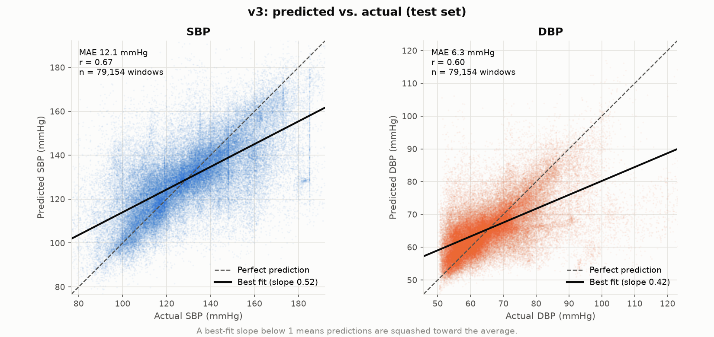
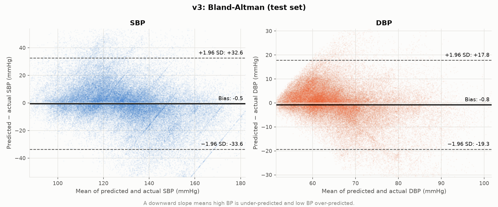
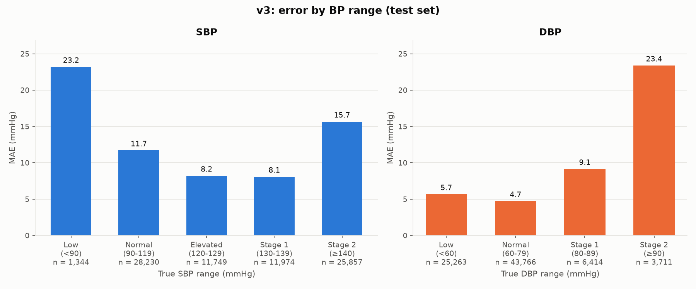

# resnet_bp_v3: evaluation summary

Cuffless blood-pressure estimation from PPG: a 1D ResNet regressing systolic (SBP) and diastolic (DBP) pressure from one 5 s window (625 samples at 125 Hz). Generated by `notebooks/evaluation_plots.py`.

## Model

- Checkpoint: `notebooks/resnet_models/resnet_bp_v3.pt`
- Architecture: 3 residual blocks (32, 64, 128 filters), global average pooling → dense 512 → dropout 0.5 → 2 outputs
- Parameters: 301,122

## Settings

| Setting | Value | Meaning |
|---|---|---|
| `use_gap` | `True` | global average pooling before the dense head |
| `kernel` | `7` | conv kernel size (samples at 125 Hz) |
| `input_channels` | `['ppg']` | input signals per window |
| `loss` | `huber` | training loss on standardized targets |
| `weight_decay` | `0.0001` | AdamW weight decay (0 = plain Adam) |

## Training

- Ran 36 epochs; best validation epoch 28 (weights kept from that epoch)
- Validation MAE at that epoch: SBP 11.90, DBP 5.84 mmHg

## Test results

79,154 test windows, split by recording (70/15/15, seed 42).

|  | MAE | RMSE | MASE | R² | ME ± SD | Slope | ≤5 / ≤10 / ≤15 mmHg | BHS | AAMI |
|---|---|---|---|---|---|---|---|---|---|
| **SBP** | 12.12 | 16.90 | 66% | 0.431 | -0.54 ± 16.89 | 0.52 | 34% / 57% / 71% | D | fail |
| **DBP** | 6.25 | 9.51 | 69% | 0.339 | -0.78 ± 9.47 | 0.42 | 57% / 82% / 91% | B | fail |
| Baseline SBP | 18.46 | 22.40 | 100% | -0.000 | -0.43 ± 22.40 | 0.00 | 15% / 30% / 46% | D | fail |
| Baseline DBP | 9.04 | 11.69 | 100% | -0.000 | -0.15 ± 11.69 | 0.00 | 31% / 63% / 88% | D | fail |

Errors in mmHg. Baseline: always predict the training-set mean. MASE: model MAE / baseline MAE. R²: share of BP variance explained. ME: mean error (bias). Slope: best-fit slope of predicted on actual (1 = no squashing). BHS: British Hypertension Society grade (A needs 60/85/95% within 5/10/15 mmHg). AAMI: |bias| ≤ 5 and SD ≤ 8 mmHg.

### Error by BP range

| Target | Range | n | MAE | ME | Baseline MAE |
|---|---|---|---|---|---|
| SBP | Low (<90) | 1,344 | 23.20 | +22.97 | 44.60 |
| SBP | Normal (90-119) | 28,230 | 11.70 | +8.88 | 21.18 |
| SBP | Elevated (120-129) | 11,749 | 8.21 | +2.84 | 4.75 |
| SBP | Stage 1 (130-139) | 11,974 | 8.08 | -0.88 | 5.19 |
| SBP | Stage 2 (≥140) | 25,857 | 15.66 | -13.44 | 26.52 |
| DBP | Low (<60) | 25,263 | 5.66 | +5.01 | 10.88 |
| DBP | Normal (60-79) | 43,766 | 4.72 | -1.21 | 4.81 |
| DBP | Stage 1 (80-89) | 6,414 | 9.15 | -7.79 | 17.05 |
| DBP | Stage 2 (≥90) | 3,711 | 23.38 | -23.08 | 32.58 |

Ranges use the true value of each target on its own. ME > 0: over-predicted on average.

## Key takeaways

1. **Clearly better than guessing the average.** Test MAE is 12.1 mmHg for SBP and 6.3 for DBP, against 18.5 and 9.0 for always predicting the training mean (MASE 66% and 69%; 100% = no better than the mean).
2. **Predictions are squashed toward the average.** The best-fit slope of predicted on actual is 0.52 for SBP and 0.42 for DBP (1.0 would be perfect), so the model follows the trend but compresses it.
3. **Errors are largest at the extremes.** SBP MAE is highest in Low (<90) (23.2 mmHg) and lowest in Stage 1 (130-139) (8.1). SBP Stage 2 (≥140) readings are under-predicted on average (ME -13.4 mmHg) and Low (<90) readings over-predicted (+23.0), the pattern the squashing predicts. The low errors in the middle are partly free: those readings sit near the average, and in Elevated (120-129) and Stage 1 (130-139) the mean predictor does even better on SBP (4.7 vs. 8.2, 5.2 vs. 8.1 mmHg). The model earns its gain at the extremes.
4. **Not clinically accurate.** Against the AAMI standard (mean error within ±5 mmHg, SD at most 8), both SBP and DBP fail (SD 16.9 / 9.5). BHS grades: SBP D, DBP B (A is best, D fails). Only 57% of SBP predictions are within 10 mmHg. That is expected for an educational prototype, but it rules out clinical use.
5. **AHA category from predicted BP:** accuracy 54.2%, macro-F1 0.501 (4 classes). The Elevated band is only 10 mmHg wide, narrower than the typical SBP error.
6. **Caveat on the split:** windows are split by recording, so no recording appears in both train and test. The UCI dataset has no patient IDs, though, and one patient can have several recordings, so these numbers may still be somewhat optimistic for truly unseen people.

## Figures

